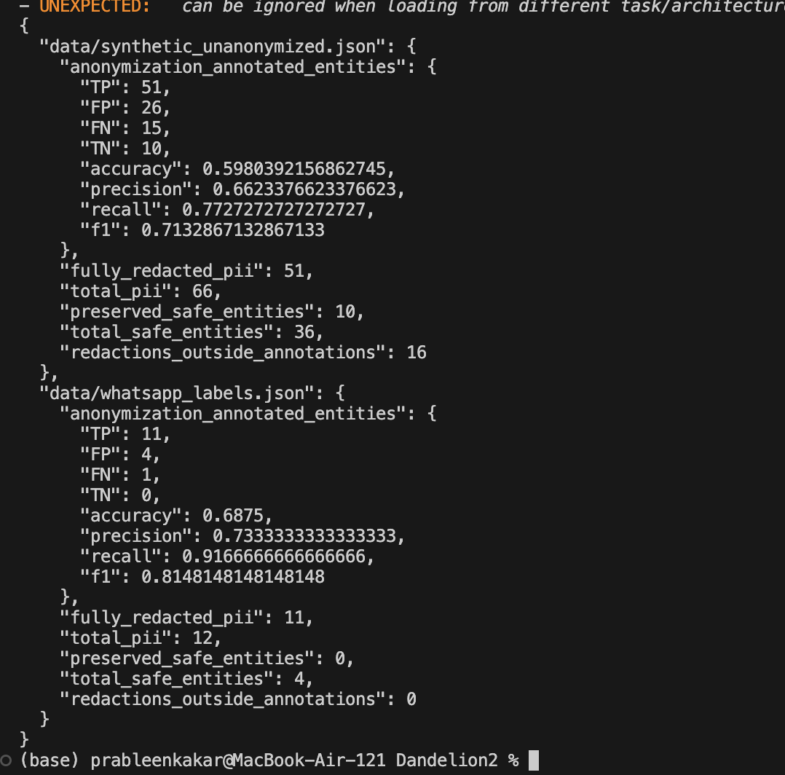
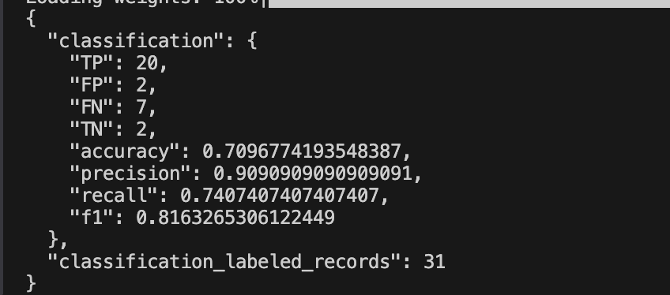
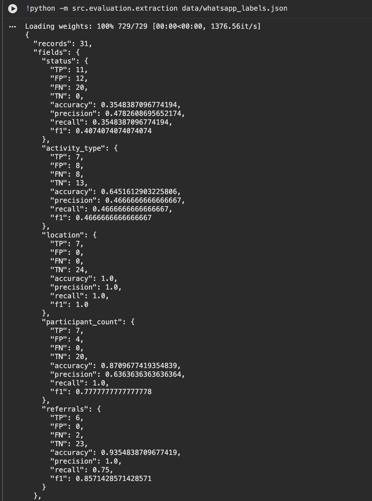
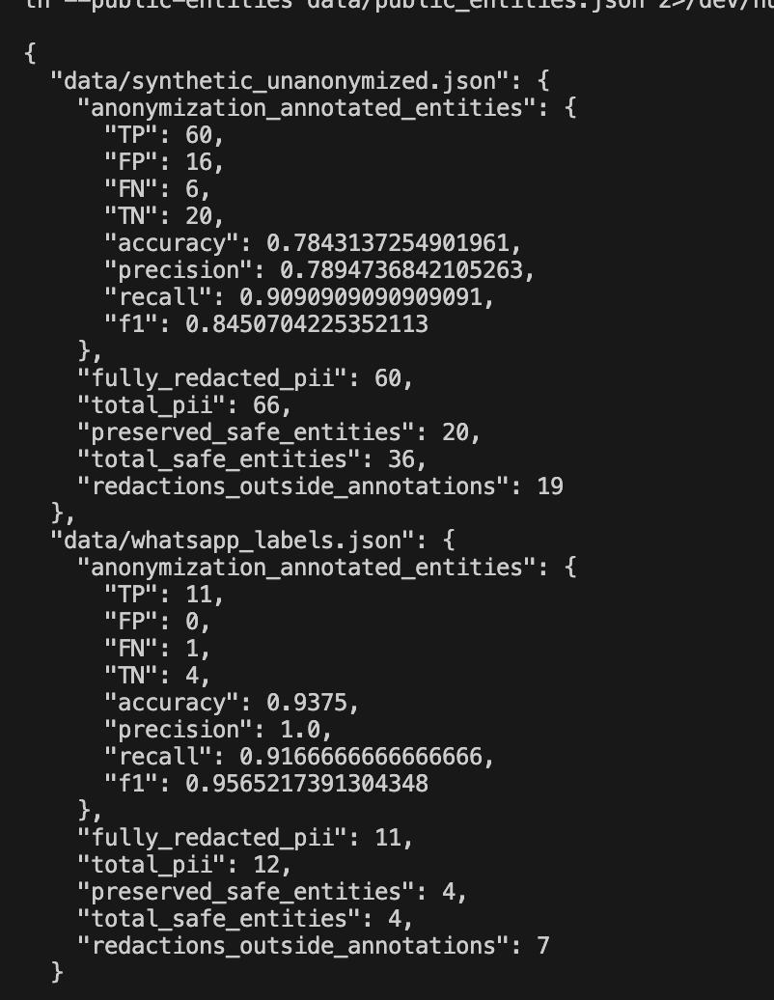
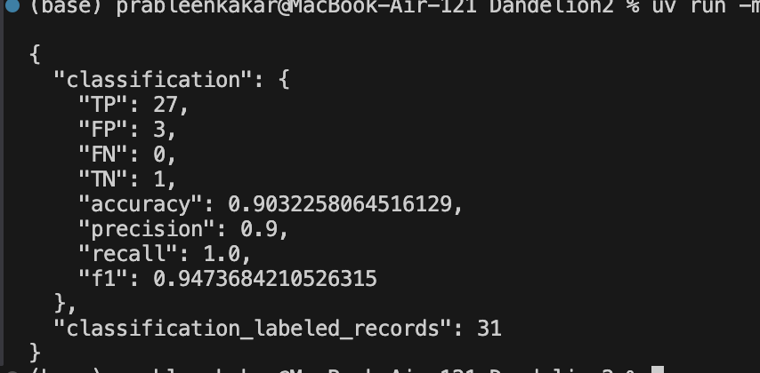

# CSEN 166 — Term Team Project for Social Impact (TTP4SI)

**Team:** D2
**Challenge:** Dandelion
**Team members:** Prableen, Priyanka, Risha, Oliver
**Repository:** https://github.com/SCU-CSEN166/Dandelion2
**Last updated:** 10-29-26

> **How to use this README:** Maintain this single file throughout the project. Complete the Week 5 project plan first, then update the appropriate weekly section before each milestone. Be specific and honest: describe what you attempted, what worked, what did not work, and what evidence supports your conclusions. For every week, document each member's actual contribution. If a task was not completed, explain the blocker and next step. Do not include private or sensitive data in this public README.

## Remember - Best Practices

### Data access and privacy
[Explain where authorized data can be accessed. Do not commit personal information, private WhatsApp exports, API keys, credentials, or restricted grant/application records. Use synthetic or anonymized examples in the README.]

### Known limitations
[Keep a current list of what the system cannot reliably do.]

## Week 5 — Scope: Project Plan

**Deliverable during Week 6 Lab:** A project plan (write in this README file) describing your problem formulation, proposed approach, each team member's responsibilities, proposed baseline models with Hugging Face links, proposed evaluation metrics, proposed data with links, and goals for each week.

### 1. Problem formulation and social impact
- **Problem:** What specific task are you solving?
  - With Dandelion Africa, data is given to us using WhatsApp exports and that data, including audio, needs to be transcribed into text, processed, and returned as a structured output. Importantly, we only want to collect and extract relevant, anonymized data.
- **Intended users:** Who would use the system, and for what decisions or activities?
  - Dandelion Africa staff would use the system to review and organize field reports quicker than manually reviewing all field reports. Primarily, staff would be most involved in verifying records produced to ensure accuracy.
- **Inputs and outputs:** What will the system receive and produce? Give one concrete example.
  - The system will recieve WhatsApp data, including text and audio, and it will produce structured records with specific details such as activity type, date, location, participant count, services provided, referrals, and outcomes.
  - Example: "Today we held a reproductive health session in Nakuru with 35 women" and our program would categorize this message as a health/wellbeing activity, include the number of women, and anonymize important information, such Nakuru.
- **Success criteria:** What would make the system useful and reliable?
  - This system will be useful only if it can be relied upon to produce accurate results that can be useful to Dandelion staff. This of course means every model we implement must be very accurate, such as text-to-speech being properly transcribed, names and other PII being properly anonymized, and relevant/important information being properly identified and extracted. As this system will never be perfect, providing a confidence score to our result can allow staff to make the final judgement.
- **Constraints and risks:** [e.g., privacy, missing data, hallucinations, language coverage, human verification]
  - One important constraint we face is that we do not have Dandelion Africa's real WhatsApp data. We are overcoming this by collecting data from Huggingface, as well as our own WhatsApp data to test our system. Of course this is not perfect as our data will not perfectly match the data from Dandelion Africa, so ensuring our system can adapt to the true data will be very important.

### 2. Proposed technical approach
- **Pipeline:**
1) Start with exported WhatsApp data (or supplemented with other data sources during testing).

2) Convert audio into text using a text-to-speech model.

3) Anonymize message, removing personal info such as names and phone numbers using a anonymization model.

4) Classify each message as either relevant or irrelevant, where irrelevant messages such as random chat messages are ignored.

5) Extract specific data from that message such as activity type or participants.

- **Baseline(s):**

Our current plan is to use pretrained models from Hugginface and analyzing how well they perform on our dataset. From their, we can measure metrics such as F1, recall, precision, and accuracy to determine how well that model is performing on our data.

- **Proposed models/tools:**

distil-whisper/distil-small.en (https://huggingface.co/distil-whisper/distil-small.en)
Speech-to-text model that translates spoken English into text.

facebook/bart-large-mnli (https://huggingface.co/facebook/bart-large-mnli) 
Sort text into categories including relevant or irrelevant.

dslim/bert-base-NER (https://huggingface.co/dslim/bert-base-NER)
Can anonymize messages to remove names, organization, locations, and other PII. We can also rely on REGEX to anomyze phone numbers in the messages.

google/flan-t5-base (https://huggingface.co/google/flan-t5-base)
This model can be used to extract data we want from the messages, such as activity or location.

sentence-transformers/all-MiniLM-L6-v2 (https://huggingface.co/sentence-transformers/all-MiniLM-L6-v2)
Can be used to compute the similarity of two messages, which can be used to build a dataset of known questions and their responses.

- **Alternative approach:**

We expect some of these models to perform poorly as some of the data these models are trained on might not match the messages we will be using. As a result, we plan on potentially fine tuning a smaller model with our known data to try to improve the performance of our system as a whole.

### 3. Proposed data
| Dataset/source | Link or access instructions | Purpose | Size / languages | Privacy or usage considerations |
|---|---|---|---|---|
| Generated WhatsApp Exports | Created by the team with supplemental messages generated from LLM | Testing and measure performance of our models with specific edge cases | Our goal is about ~100 messages | Fake data only, so no privacy concerns |
| Public WhatsApp Exports | Can be found online, such as on Huggingface | Can be used to measure performance of our models on a large set of messages | Potentially thousands. Depends on size of dataset. | We will only use WhatsApp exports that are publicly available and free for use. |
| Public English accent speech data | Hugging Face/public dataset | Test speech to text models with different accents and speakers | Depends on dataset. Potentially hundreds of english phrases | Follow license on dataset and ensure it is free for public use. |
| AI-generated paraphrases | Created from existing data | Can increase the amount of data we use when testing our system | Depends on how much variation we have in our initial data, and how much we need to supplement | Review resulting dataset for accuracy and any other privacy concerns. | 

- **Data preparation:** 
Once we have our data, we will need to ensure it has names and locations for our anonymization model as well as a relevant activity at a location with attending participants. During testing, we can manually label this data to check our system accuracy. 
- **Data limitations:** The dataset we work with in this project will not be the same data as the real Dandelion data, so we will need to be aware of that during development. This is especially important as we need to be aware of different writing styles or background noise in Dandelion Africa that might not be present in our dataset.

### 4. Proposed evaluation
| Metric / test | What it measures | How it will be calculated | Target / success criterion |
|---|---|---|---|
|Recall| Can be used for anonymization as we will want to know how good we are at completely anonomyzing a source | TP/(TP+FN) where TP is the number of successful anonymizations, and FN is data that should be anonymized but wasn't. | Ideally we want as close to 100% accuracy as possible because we do not want to let personal information into our data.
| Precision | Of the data we extracted, how much was correct and not extracted accidentally | TP / (TP+FP) where TP is data successfully extracted and FP is data extracted that should not have been extracted | We want this to perform better than trying to trivially match keywords in the text
| F1 | Can use to determine how well we classify activities in messages | 2pr/(p+r) where p = precision and r = recall | We will want this to perform significantly better than checking for just checking for certain keywords in the messages
| Confusion matrix | Shows the True Positive, False Positive, True Negative, and False Negative results from our classifer, such as anonymization and extraction | Create chart with predicted class and actual class | Ideally, we want TP and TN to be much higher than FP and FN.

- **Evaluation examples:** We will use our synthetic dataset which we will know how many anonymizations are needed and what data needs to be extracted. We can run our model on that data and compare the results against the known answer.
- **Human verification:** Either our Data Collection team member or classisification and anomyization team member will oversee our test results against the expected answers from our data to determine if any of our classifiers are performing badly.
- **Failure cases to watch:** 
- One problem might be with our speech to text transcriber turning names, addresses, or phone numbers into data that will be much harder to be caught by the classifier. For example, a phone number might be transcribed as just a 9 digit number and might be missed by our anonymizer.
- Another problem might be overfitting of our models. This is especially important given that our synthetic data may not actually align perfectly with the real-world data. It will be important our models are able to adapt to new and different forms of information.

### 5. Team responsibilities
| Member | Primary responsibility | Specific Weekly contribution | Planned next task |
|---|---|---|---|
| Risha Desai | Data collection & analysis | Collect and test data from HuggingFace, Claude/AI, and team-made | Continue building out dataset with realistic data with audio. |
| Priyanka Ganguly | STT from audio in dataset | Evaluate the speech dataset and models using precision, recall, and T1 | Experiment with other STT models and evaluate their performance. |
| Prableen Kakar | Classification and anonymization | Evaluate dataset using anonymization and classification models | Experiment with different models on different datasets and sources. |
| Oliver Ortiz | Extraction & Integration | Primary Python implementation, input, and output, and addition work on extraction | Build out complete end to end pipeline of work. |

## Week 6 — Build: Working Baseline

**Deliverable during Week 7 Lab:** A runnable baseline, setup/run instructions, and 1–2 example inputs and outputs. Update this section with what worked, what failed, and individual contributions.

### Implementation status
- **What runs end-to-end now?** Currently, we have implemented full end-to-end capability using our baseline models. Our system takes in some source as input (such as exported WhatsApp data), and other supplemental data where necessary. That message is passed through the speech to text model (where necessary), anonymization model, classification model, and extraction model and the output is exported as a end-result.
- **How to run it:**
1) Install ffmpeg: `brew install ffmpeg` (MacOS)
2) Clone Repo: `git clone https://github.com/SCU-CSEN166/Dandelion2.git`
3) CD into cloned repo
4) Install UV: `pip install uv` or `pip3 install uv`
5) Sync project: `uv sync`
6) Run: `uv run main.py` to run the complete end-to-end system. Inputted data can be changed in main.py. Outputted data is saved in output folder.
7) Or, run individual evaluations
Anonymization: `uv run -m src.evaluation.anonymization data/synthetic_unanonymized.json data/whatsapp_labels.json`
Classification: `uv run -m src.evaluation.classification data/whatsapp_labels.json`
Extraction: `uv run -m src.evaluation.extraction data/whatsapp_labels.json`
Speech to text: `uv run -m src.evaluation.transcription`

- **Model(s) and data actually used:**

Models:
Speech to text: https://huggingface.co/distil-whisper/distil-small.en
Anonymization: https://huggingface.co/dslim/bert-base-NER
Relevance: https://huggingface.co/facebook/bart-large-mnli
Extraction: https://huggingface.co/numind/NuExtract-2.0-2B
  - Originally we had planned to use google/flan-t5-base for extraction, however we switched to NuExtract as it can fill a given template whereas flan-t5 could extract specific information given, which would be more unreliable in extracting obscure information.
We used openai/whisper-small.en to do the comparsion speech-to-text model. 

Data:
- data/WhatsAppExports/export2 is WhatsApp data we created to test data actually from WhatsApp. We then manually labeled that data in data/whatsapp_labels.json.
- We also have labaled anonymization data generated with help of AI and human review to evaluate our anonymization model with fake PII.
- Testing with accented audio messages from Huggingface dataset: https://huggingface.co/datasets/benjaminogbonna/nigerian_accented_english_dataset
- Tested with a data of introhealth/afrispeech-dialog, that was filtered to country = KE, there were 9 Kenyan conversations available in Swahili-accented English and the domain was general. We selected 3 conversations and tested the first 30 seconds of each for more speech-to-test robustness testing. Then these results were saved as two CSV files. 

- **Example 1:** 

Input: `uv run main.py --message "Grace Wanjiru is handling them. Her number is 0712 345 678 if the clinic needs to reach her."`
Output: {
  "id": "cli:0",
  "conversation": null,
  "timestamp": null,
  "sender": null,
  "text": "[PERSON] is handling them. Her number is [PHONE] if the clinic needs to reach her.",
  "relevance_score": 0.66,
  "status": "neither",
  "activity_type": "other",
  "location": null,
  "participant_count": null,
  "referrals": null,
  "needs_review": []
}
- **Example 2:** 
Input: `uv run main.py --message "Today we held a family planning out outreach in Nakuru. 31 women attended and 4 were referred to the clinic for follow-up."`
Output: {
  "id": "cli:0",
  "conversation": null,
  "timestamp": null,
  "sender": null,
  "text": "Today we held a family planning out outreach in [LOCATION]. 31 women attended and 4 were referred to the clinic for follow-up.",
  "relevance_score": 0.943,
  "status": "completed",
  "activity_type": "family planning outreach",
  "location": "[LOCATION]",
  "participant_count": 31,
  "referrals": 4,
  "needs_review": []
}

### Attempts and outcomes
| Attempt / change | Worked? (Yes / Partly / No) | Evidence (output, metric, link) | What we learned / next step |
|---|---|---|---|
| Anonymization on the 20 synthetic records (data/synthetic_unanonymized.json) | Partly | TP 51, FP 26, FN 15, Precision 0.6623, Recall 0.7727, F1 0.7133 | missed lowercase/Swahili names and hid public places too so will try GLiNER and add a public-places list |
| Trying to do PII anonymization on the 31 message set we have from WhatsApp | Yes | TP 11, FP 4, FN 1, Precision 0.7333, Recall 0.9167, F1 0.8148 | performed decently but one PII section was missed |
| Classifying relevance on 31 already labeled messages | Partly | Accuracy 0.7097, Precision 0.9091, Recall 0.7407, F1 0.8163 | The precision was high so this is good but some relevant messages were missed | 
| test Distil-Whisper on our 3 synthetic WhatsApp voice notes | Partly | all 3 transcribed, but some errors like sleep being steep and curve being curb, especially mistakes with slang | compare another Whisper model and test more accented audio |
| test speech-to-text on Kenyan AfriSpeech-Dialog samples | Partly | 3 Kenyan/Swahili-accented convos, first 30 secs of each, Distil-Whisper produced transcripts, saved the comparison in CSV file | can't claim WER yet, reference transcripts cover full conversations and are not aligned to the 30 sec segments |
| Extracting data to json format | Partly | output/evaluation/extraction.json. Overall, extraction worked well at extracting details except struggled with status (such as if a task is completed, planned, or neither). | We believe this is caused by extraction only extracting data from that specific message, and ignoring context from previous messages which could help the model know if the task is completed or not. |


This is the anonymization results on both datasets (the 20 synthetic records and the 31 WhatsApp messages). The biggest takeaway was that recall scores being 0.77 (synthetic) vs. 0.92 (WhatsApp). The synthetic set is probably harder because of lowercase/Swahili names.


This is the relevance classification on 31 labeled WhatsApp messages. Overall, has high precision but missed 7 relevant messages which were mostly future planned events because model is told that future plans are irrelevant.



### Individual contributions during that week
| Member | What I personally implemented/tested | Result (worked / partly / failed) | Evidence (commit, PR, experiment) | Blocker / next step |
|---|---|---|---|---|
| Priyanka Ganguly | I streamed 10 test clips from the Nigerian-accented English dataset through Distil-Whisper. I compared it's transcripts with the references and calculated WER. | Partly because the transcription run completed and WER was 0.423. I saw that the accuracy varied in the sense that short clips were transcribed closely while I saw some errors in some names and longer clips.  Since I only used 10 clips, the result is preliminary for now. | https://colab.research.google.com/drive/1Ba0hFutu98B9gEcrXRTVKFOdV_9Z3mNd?usp=sharing | The result is only from 10 clips, so I want to test more data/examples (maybe 50+ more clips with short and longer recordings). I will compare another speech to text model on the same clips to see if I can get better accuracy in my results.  |
| Risha Desai | I helped create four synthetic WhatsApp conversations. I included completed events, planned events, irrelevant messages, PII, not completed details messages, and almost duplicate reports. I exported the WhatsApp chat with audio too. This was then added to the repo and I created whatsapp_labels.json. This was where the ground-truth laid as the 31 labeled messages. The labels included relevance, event status, activity type, location, counts, referrals, PII, event IDs, and if there was a duplicate relationship. I created audio_ground_truth.json, as well as adding the ground-truth transcripts for the 3 WhatsApp voice notes. Then this labeled dataset was used for model evaluation. I also found AfriSpeech-Dialog to use as another public dataset. I filtered that to only Kenyan or Swahili-accented English. Then picked 3 samples and tested the first 30 seconds. I ran Distil-Whisper on them and then compared Whisper models on the same samples. | Creating the data: worked, Labeling: worked Anonymization testing: worked great on our WhatsApp set, Relevance testing: partly worked since some of the relevant messages were missed, Audio transcription: partly worked since I observed slang and individual words were incorrectly transcribed | whatsapp_labels.json, audio_ground_truth.json, exported WhatsApp data, test_results.md. Also the two CSV files of the Afrispeech Kenyan/Swahili accented data is in afrispeech_kenya_distilwhisper_results.csv and in afrispeech_kenya_model_comparison.csv. Again, the experiment is documented in test_results.md. | Next steps are to add duplicate-events and test/evaluate that. I want to test more audio too and try to find different accents. Comparing Distil-Whisper with Whisper Small is important too. I also want to improve the relevance recall since this is significant for Dandelion themselves. Lastly, I want to evaluate extraction on more already labeled messages. | 
| Oliver Ortiz | This week, I focused on building out the pipeline that we will use to run messages and data through. I was provided implementations of many of the models by my teammates which I then implemented into our stack. I completed the full end-to-end system and was able to test it on some data provided by another teammate. Additionally, I was also responsible for implementing the final extraction model as that was the final model before output. | Overall, this process was a success as each part of the system came together perfectly. We currently have a complete baseline system which we can evaluate further and find the areas to focus most on improving. | Primarily my work is in the src/ directory. The primary code my teammates used to teach each model is in src/evaluation, and the implementation of each model are in their respective .py file in src/. | Next steps for this project are going to be testing out different models and processes for getting an accurate output. In the main end-to-end system this might mean abstracting some systems to make it easier to quickly test different models and tools.
| Prableen Kakar | I built the anonymization and relevance steps. Anonymization uses a BERT model (dslim/bert-base-NER) to find names, places and organizations and regex patterns for phone numbers, national IDs and emails, and replaces them with tags like [PERSON] or [PHONE]. Relevance uses a zero-shot model (facebook/bart-large-mnli) that scores each message against "a report of completed activities" versus "casual conversation or plans for future activities" (0.5 or higher = relevant). I also wrote the evaluation script (TP/FP/FN/TN, precision, recall, F1) and unit tests, and tested on the 20 synthetic records and the 31 labeled WhatsApp messages. | Anonymization mostly worked on synthetic data: it hid 51 of 66 private items (recall 0.77, precision 0.66, F1 0.71). It missed lowercase/Swahili names like "wanjiru" and hid public places like Baringo County. It worked well on WhatsApp since it hid 11 of 12 private items including every name and phone number (recall 0.92, precision 0.73, F1 0.81). Relevance kind of worked: 22 of 31 correct (accuracy 0.71, precision 0.91, recall 0.74, F1 0.82). 4 of the 7 missed relevant messages were planned events because the classifier only counts completed activities as relevant but our labeling also count plans. | Commit 6c10379 (original baseline). Code is in src/anonymize.py, src/relevance.py, src/evaluation/anonymization.py and src/evaluation/classification.py. Screenshots: screenshots/anonymization_results.png and screenshots/classification_results.png. | Test GLiNER (knowledgator/gliner-pii-base-v1.0) to catch the lowercase/Swahili names and compare its recall and precision with BERT. Add a reviewed list of public places that should stay visible and not get hidden. Decide with team whether future planned events count as relevant. |


AI Disclosure:
- Overall, used for brainstorming and feedback as we developed this baseline system.
- AI was used to write the code to load in data (such as WhatsApp or other formatted data). AI was also used to integrate out independent tests of each into the main pipeline. Also used it for main.py
- data/synthetic_unanonymized.json for anonymization test cases

---

## Week 7 — Evaluate: Results Checkpoint

**Deliverable during Week 8 Lab:** Preliminary evaluation results, metrics, development-set details, and 2–3 representative successes or failures. Include what you will improve next.

### Evaluation setup
- **Development data:** The development data we used was 31 labeled-by-us synthetic WhatsApp messages. The labels included relevance, PII, status, activity type, location, participant count, referrals, event IDs, and duplicate relationships. We had 3 synthetic WhatsApp voice memos with ground-truth transcripts. We used 10 accented-English audio clips which was scores and tested for ASR. Lastly, we used 3 Kenyan AfriSpeech-Dialog samples for more qualitative ASR testing, found from hugging face. 
- **Metrics and rationale:** For anonymization we used precision, recall, and F1 score. For relevance classification we did used accuracy, precision, recall, and F1 score. For ASR we used WER score. Recall is very important for anonymization since missed PII is a privacy risk. Relevance recall matters since missed relevant messages mean there was field information lost. 
- **Comparison:** Week 7 evaluates the Week 6 baseline on the labeled text and audio data. We're testing the updated anonymization and public place setup and are goinng to compare that on the same labeled WhatsApp set. 

| System / version | Metric 1 | Metric 2 | Notes |
|---|---:|---:|---|
| Speech-to-text baseline | 0.423 WER | .203 CER | These results are from distil-whisper/distil-small.en. We found that openai/whisper-small.en performed better, but took much longer to run |
| Speech-to-text improved | 0.138 WER | 0.049 CER | Switched to a more clear dataset which drastically improved our results |
| Extraction baseline | 1.0 F1 Location | 0.40 F1 status | This model performed perfectly extracting locations, however struggled with extracting status of activity, which might mean that we need a seperate model to extract status |
| Anonymization Baseline | 0.773 Recall | 0.713 F1 | BERT + regex on the 20-record synthetic PII set |
| Updated Anonymization | 0.909 Recall | 0.845 F1 | BERT + GLiNER + reviewed public places, with fewer false positives and false negatives |
| Classification Baseline | 0.909 Precision | 0.816 F1 | Classifying data as relevant or irrelant also performed okay, however there is room for improvement by continueing to experiment with different models |
| Anonymization baseline (BERT + regex), synthetic | Recall 0.77 | Precision 0.66 | F1 0.71. 15 of 66 private items were leaked. |
| GLiNER instead of BERT, synthetic | Recall 0.77 | Precision 0.67 | F1 0.72. Same number of words hidden but just different ones. |
| BERT and GLiNER together, synthetic | Recall 0.91 | Precision 0.69 | F1 0.78. Leaks went down from 15 to 6. |
| **Current: BERT + GLiNER + public places, synthetic** | **Recall 0.91** | **Precision 0.79** | **F1 0.85** |
| Anonymization baseline, WhatsApp | Recall 0.92 | Precision 0.73 | F1 0.81. All 4 safe place names were hidden. |
| **Current: BERT + GLiNER + public places, WhatsApp** | **Recall 0.92** | **Precision 1.00** | **F1 0.96.** Place names like Nakuru aren't hidden now. |
| Relevance baseline (completed only), WhatsApp | Recall 0.74 | Precision 0.91 | F1 0.82, accuracy 0.71. It missed 7 relevant messages and 4 of them were future planned events. |
| Relevance, future plans count as relevant, WhatsApp | Recall 1.00 | Precision 0.90 | F1 0.95, accuracy 0.90. Looks better but could be better. |





Anonymization with BERT and GLiNER and the public places list. On the synthetic records it now hides 60 of 66 private items (which is up from 51!) and on WhatsApp nothing safe gets hidden anymore.


This is the relevance result when planned events count as relevant. It found all 27 relevant messages but it also marks a lot of casual words (like 'nice' or 'agree') as relevant. Our data only has 4 irrelevant messages so the score doesn't show this problem.

### Successes, failures, and interpretation
| Example / category | Expected behavior | Actual behavior | Success or failure? | Likely reason |
|---|---|---|---|---|
| Lowercase Swahili message: "ni wanjiru kutoka mau narok" | Hide "wanjiru" and "mau narok" | Baseline missed both. BERT + GLiNER now hides "wanjiru", but still misses "mau narok". | Partly | BERT learned from capitalized English news. GLiNER handles lowercase names better, but neither recognized this place. |
| Date of birth: "DOB 04/11/1998" | Hide the date | Baseline missed it. GLiNER hides it. | Success | BERT has no date of birth category. GLiNER lets us ask for one. |
| Public place: "today's Nakuru outreach was 31 women" | Keep "Nakuru" visible | Baseline hid it as [LOCATION]. Now it stays visible. | Success | The new public places list (Kenya's 47 counties) tells the code which places are safe. |
| Casual chat: "nice", "agree", "yall think we're gonna get the midterm back soon" | Irrelevant | With plans counted as relevant, these get marked relevant. On 18 unlabeled chat messages, 14 were marked relevant (vs. 6 before). | Failure | The new wording ("about an activity") is so broad it matches almost anything. Our labels only have 4 irrelevant messages, so the score doesn't catch it. |
| "I think 9am but I'll double check" | Nothing hidden | GLiNER turns it into "[PERSON]'ll double check" | Failure (minor) | GLiNER sometimes treats "I" as a person. It doesn't leak anything, but it makes the text messier. |
| reviewed public location | keep public location visible while masking private PII | public place stayed visible | success | reviewed public-entity allowlist | 
| msg_012 "just recommend rn, i dont think theyve gone to the clinic yet" | relevant | predicted irrelevant | | failure | fragmented and informal wording and not having the prior conversation context |

- **What improved?** We had anonymization recall improve from 0.773 to 0.909. As well as anonymization F1 improved from 0.713 to 0.845. The false negatives dropped so that means fewer PII entities were missed. The public-place handling reduced unnecessary masking. 
- **What did not improve?** Relevance still missed the messages that depended on context. There were 7 false negatives and 2 false positives. Examples of this asre msg_004, msg_012, and msg_027. 
- **Next experiment:** We will keep evaluating the updated anonymization setup on the same labeled data and check into whether the gains hold across more cases. We will also check on relevance-policy consistency and rerunning relevance metrics. 

### Individual contributions during that week
| Member | Work completed | Result (worked / partly / failed) | Evidence | Next step |
|---|---|---|---|---|
| Oliver Ortiz | This week, I continued to add in new models to our end-to-end pipeline. I also added our repo to Colab and ran it on numerous inputs to evaluate our current models. | W.I.P. Still need to get more data and find more models to improve performance in certain aspects of our code. | https://colab.research.google.com/drive/1o1VLE-ld7YXWmWRcteyG6sX7fonIrR-4?usp=sharing | Continue to add more models and test our pipeline |
| Prableen Kakar | I tried three fixes for the problems from Week 6. First, I added GLiNER (knowledgator/gliner-pii-base-v1.0), a model made for private information to catch the lowercase names and dates of birth that BERT missed. I also added an option to run BERT and GLiNER together. Second, I added a list of public places (Kenya's 47 counties, Dandelion Africa, Ministry of Health) that should not be hidden by anonymization so we stop hiding useful locations. I built it from a general list, not from our test labels. Lastly, I added an option to count planned events as relevant since 4 of the 7 relevance misses were planned events. I added switches to the evaluation scripts (--ner bert/gliner/both, --public-entities, --count-plans) and compared every version on the same data. | What worked was BERT and GLiNER and public places raised synthetic recall from 0.77 to 0.91 and F1 from 0.71 to 0.85, and WhatsApp precision from 0.73 to 1.00. GLiNER by itself just scored the same as BERT so it kind of worked. Counting plans found every planned event (recall 1.00) but it also marked most of the casual chat as relevant. | Commit 89cd752 (code), commit 88eeca5 (screenshots). Code: src/anonymize.py (GlinerNER, CombinedNER), src/relevance.py (count_plans), src/evaluation/anonymization.py, src/evaluation/classification.py, data/public_entities.json. Screenshots: screenshots/week7_anonymization_bert_gliner_public.png, screenshots/week7_relevance_count_plans.png | Label the rest of the 45 chat messages and re-compare the relevance versions. Also, try a higher threshold for the plans version. Also, add regex for record numbers and M-Pesa codes (Kenya's mobile money service). |
| Risha Desai | I ran relevance evaluation on the 31-message labeled WhatsApp evaluation subset we picked, and compared those predictions against our chosen ground-truth. I identified 7 false negatives and 2 false positives and analyzed which of those errors were context and slang failures vs planned/future-label inconsistencies. Then I documented these results in data/relevance_error_analysis.md. | The evaluation worked and the error analysis was completed, but relevance classification still missed some context-dependent messages and informal language messages. | The evidence is in data/relevance_error_analysis.md and output/evaluations/classification.json | I will revisit the planned/future-event relevance policy next week and ensure the labels are consistent with that policy, rerun the same evaluation, and compare the updated precision, recall, and F1 (our important metrics). | 

---

## Week 8 — Stress-Test: Reliability on Hidden Data

**Deliverable during Week 9 Lab:** Hidden-test results (as provided by the TA), analysis of at least three important failure cases, and a prioritized improvement plan.

- **Submitted system version / commit:** [Commit hash]
- **Hidden-test metrics and leaderboard result:** [Results, when available]
- **Difference from development results:** [Compare; do not assume the hidden set is identical]

| Failure case / category | What went wrong | Possible cause | Severity / user impact | Proposed fix |
|---|---|---|---|---|
| [Case 1] | [Observation] | [Hypothesis] | [Impact] | [Fix] |
| [Case 2] | [Observation] | [Hypothesis] | [Impact] | [Fix] |
| [Case 3] | [Observation] | [Hypothesis] | [Impact] | [Fix] |

### Changes attempted after stress-testing
| Change | Worked? (Yes / Partly / No) | Evidence | Keep, revise, or revert? |
|---|---|---|---|
| [Change] | [Status] | [Result] | [Decision] |

### Individual contributions during that week
| Member | Work completed | Result (worked / partly / failed) | Evidence | Next step |
|---|---|---|---|---|
| [Name] | [Specific work] | [Status] | [Link] | [Next step] |

---

## Week 9 — Responsible AI, Peer Testing, and Final Delivery

**Deliverable during Week 10 Lab:** Document peer-testing feedback, Responsible AI concerns, changes made in response, and the final runnable system. Submit the final project report as instructed.

### Peer testing
- **Team evaluated:** [Team ID]
- **One thing that worked well:** [Evidence]
- **One meaningful failure:** [Reproduction steps or example]
- **One actionable recommendation:** [Specific fix]
- **Feedback received from another team:** [Summary]

### Responsible AI assessment
- **Potential harms or affected users:** [Who could be affected and how?]
- **Privacy and data handling:** [How sensitive information is protected]
- **Reliability and unsupported claims:** [How outputs are verified or uncertainty is communicated]
- **Fairness, accessibility, and usability:** [Relevant concerns and tests]
- **Human oversight:** [Where a human should review or correct outputs]
- **Remaining limitations:** [What should not be trusted or deployed yet]

### Final improvements and outcomes
| Feedback / issue | Change made | Worked? (Yes / Partly / No) | Evidence | Remaining limitation |
|---|---|---|---|---|
| [Issue] | [Change] | [Status] | [Link or metric] | [Limitation] |

### Individual contributions during that week
| Member | Final implementation / evaluation / documentation contribution | Result (worked / partly / failed) | Evidence | Reflection / remaining work |
|---|---|---|---|---|
| [Name] | [Specific work] | [Status] | [Link] | [Reflection] |


### Final submission checklist
- [ ] Code and final system/prototype are in the repository
- [ ] Setup and run instructions are complete and tested
- [ ] Data sources, model versions, and dependencies are documented
- [ ] Evaluation results are reported and compared with the baseline
- [ ] Important failures and limitations are explained
- [ ] Hidden-test and peer-feedback findings are addressed
- [ ] Responsible AI considerations and human oversight are discussed
- [ ] Every team member's contributions are documented for every week

**Final commit / release:** [Commit hash or tag]

---

## Setup and Reproducibility (keep updated)

### Requirements
[Python version, libraries, compute requirements, model access]

### Installation
```bash
# Add installation commands here
```

### Run the system
```bash
# Add an example command here
```

### Run evaluation
```bash
# Add an example evaluation command here
```

### Repository structure
```text
project/
├── README.md
├── requirements.txt
├── src/
├── tests/
├── evaluation/
└── examples/
```


