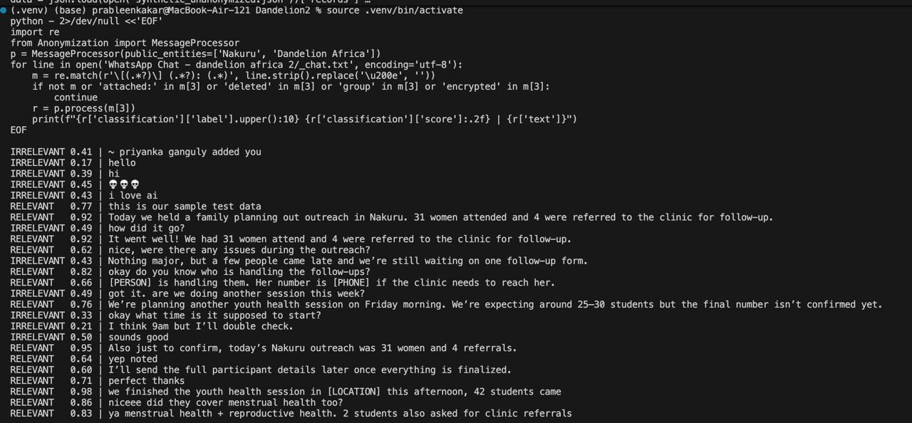
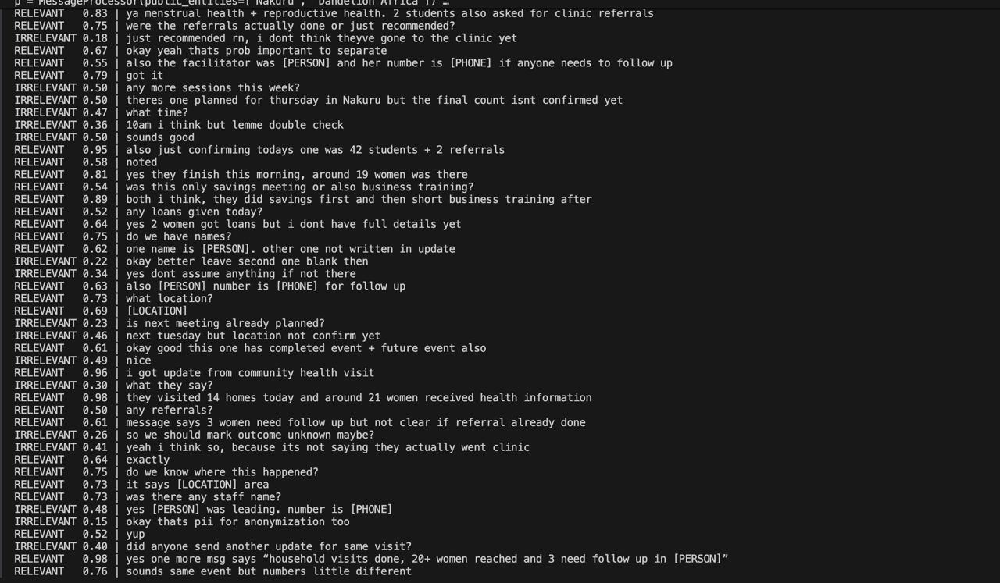
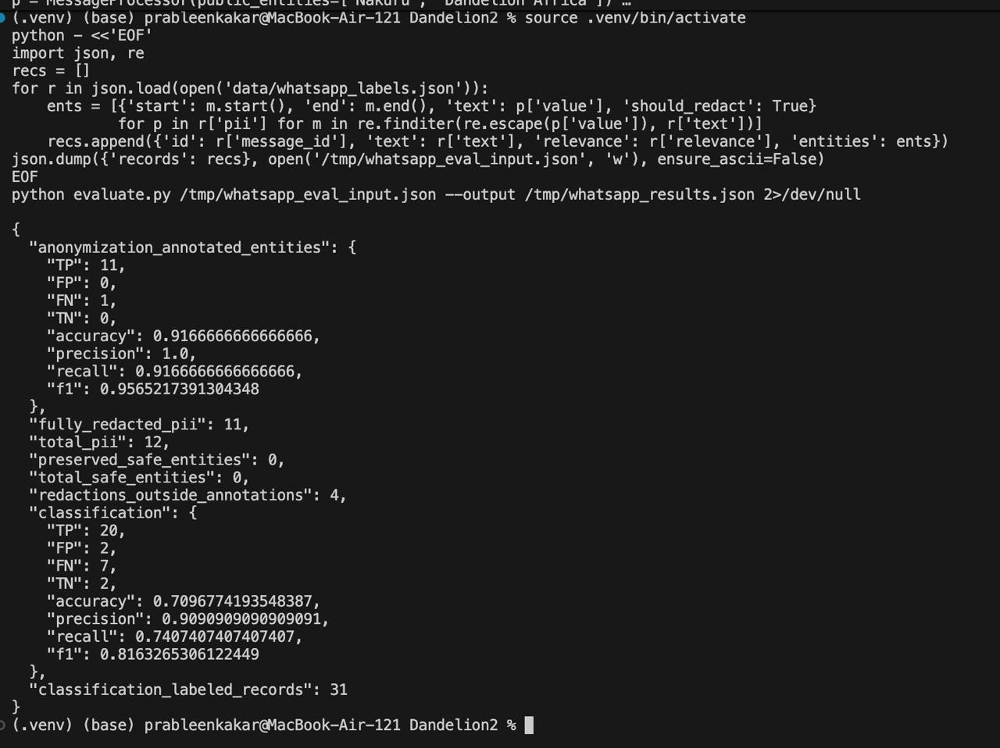

# CSEN 166 — Term Team Project for Social Impact (TTP4SI)

**Team:** D2
**Challenge:** Dandelion
**Team members:** Prableen, Priyanka, Risha, Oliver
**Repository:** https://github.com/SCU-CSEN166/Dandelion2
**Last updated:** 10-29-26

> **How to use this README:** Maintain this single file throughout the project. Complete the Week 5 project plan first, then update the appropriate weekly section before each milestone. Be specific and honest: describe what you attempted, what worked, what did not work, and what evidence supports your conclusions. For every week, document each member's actual contribution. If a task was not completed, explain the blocker and next step. Do not include private or sensitive data in this public README.

## Remember - Best Practices

### Data access and privacy
[Explain where authorized data can be accessed. Do not commit personal information, private WhatsApp exports, API keys, credentials, or restricted grant/application records. Use synthetic or anonymized examples in the README.]

### Known limitations
[Keep a current list of what the system cannot reliably do.]

## Week 5 — Scope: Project Plan

**Deliverable during Week 6 Lab:** A project plan (write in this README file) describing your problem formulation, proposed approach, each team member's responsibilities, proposed baseline models with Hugging Face links, proposed evaluation metrics, proposed data with links, and goals for each week.

### 1. Problem formulation and social impact
- **Problem:** What specific task are you solving?
  - With Dandelion Africa, data is given to us using WhatsApp exports and that data, including audio, needs to be transcribed into text, processed, and returned as a structured output. Importantly, we only want to collect and extract relevant, anonymized data.
- **Intended users:** Who would use the system, and for what decisions or activities?
  - Dandelion Africa staff would use the system to review and organize field reports quicker than manually reviewing all field reports. Primarily, staff would be most involved in verifying records produced to ensure accuracy.
- **Inputs and outputs:** What will the system receive and produce? Give one concrete example.
  - The system will recieve WhatsApp data, including text and audio, and it will produce structured records with specific details such as activity type, date, location, participant count, services provided, referrals, and outcomes.
  - Example: "Today we held a reproductive health session in Nakuru with 35 women" and our program would categorize this message as a health/wellbeing activity, include the number of women, and anonymize important information, such Nakuru.
- **Success criteria:** What would make the system useful and reliable?
  - This system will be useful only if it can be relied upon to produce accurate results that can be useful to Dandelion staff. This of course means every model we implement must be very accurate, such as text-to-speech being properly transcribed, names and other PII being properly anonymized, and relevant/important information being properly identified and extracted. As this system will never be perfect, providing a confidence score to our result can allow staff to make the final judgement.
- **Constraints and risks:** [e.g., privacy, missing data, hallucinations, language coverage, human verification]
  - One important constraint we face is that we do not have Dandelion Africa's real WhatsApp data. We are overcoming this by collecting data from Huggingface, as well as our own WhatsApp data to test our system. Of course this is not perfect as our data will not perfectly match the data from Dandelion Africa, so ensuring our system can adapt to the true data will be very important.

### 2. Proposed technical approach
- **Pipeline:**
1) Start with exported WhatsApp data (or supplemented with other data sources during testing).

2) Convert audio into text using a text-to-speech model.

3) Anonymize message, removing personal info such as names and phone numbers using a anonymization model.

4) Classify each message as either relevant or irrelevant, where irrelevant messages such as random chat messages are ignored.

5) Extract specific data from that message such as activity type or participants.

- **Baseline(s):**

Our current plan is to use pretrained models from Hugginface and analyzing how well they perform on our dataset. From their, we can measure metrics such as F1, recall, precision, and accuracy to determine how well that model is performing on our data.

- **Proposed models/tools:**

distil-whisper/distil-small.en (https://huggingface.co/distil-whisper/distil-small.en)
Speech-to-text model that translates spoken English into text.

facebook/bart-large-mnli (https://huggingface.co/facebook/bart-large-mnli) 
Sort text into categories including relevant or irrelevant.

dslim/bert-base-NER (https://huggingface.co/dslim/bert-base-NER)
Can anonymize messages to remove names, organization, locations, and other PII. We can also rely on REGEX to anomyze phone numbers in the messages.

google/flan-t5-base (https://huggingface.co/google/flan-t5-base)
This model can be used to extract data we want from the messages, such as activity or location.

sentence-transformers/all-MiniLM-L6-v2 (https://huggingface.co/sentence-transformers/all-MiniLM-L6-v2)
Can be used to compute the similarity of two messages, which can be used to build a dataset of known questions and their responses.

- **Alternative approach:**

We expect some of these models to perform poorly as some of the data these models are trained on might not match the messages we will be using. As a result, we plan on potentially fine tuning a smaller model with our known data to try to improve the performance of our system as a whole.

### 3. Proposed data
| Dataset/source | Link or access instructions | Purpose | Size / languages | Privacy or usage considerations |
|---|---|---|---|---|
| Generated WhatsApp Exports | Created by the team with supplemental messages generated from LLM | Testing and measure performance of our models with specific edge cases | Our goal is about ~100 messages | Fake data only, so no privacy concerns |
| Public WhatsApp Exports | Can be found online, such as on Huggingface | Can be used to measure performance of our models on a large set of messages | Potentially thousands. Depends on size of dataset. | We will only use WhatsApp exports that are publicly available and free for use. |
| Public English accent speech data | Hugging Face/public dataset | Test speech to text models with different accents and speakers | Depends on dataset. Potentially hundreds of english phrases | Follow license on dataset and ensure it is free for public use. |
| AI-generated paraphrases | Created from existing data | Can increase the amount of data we use when testing our system | Depends on how much variation we have in our initial data, and how much we need to supplement | Review resulting dataset for accuracy and any other privacy concerns. | 

- **Data preparation:** 
Once we have our data, we will need to ensure it has names and locations for our anonymization model as well as a relevant activity at a location with attending participants. During testing, we can manually label this data to check our system accuracy. 
- **Data limitations:** The dataset we work with in this project will not be the same data as the real Dandelion data, so we will need to be aware of that during development. This is especially important as we need to be aware of different writing styles or background noise in Dandelion Africa that might not be present in our dataset.

### 4. Proposed evaluation
| Metric / test | What it measures | How it will be calculated | Target / success criterion |
|---|---|---|---|
|Recall| Can be used for anonymization as we will want to know how good we are at completely anonomyzing a source | TP/(TP+FN) where TP is the number of successful anonymizations, and FN is data that should be anonymized but wasn't. | Ideally we want as close to 100% accuracy as possible because we do not want to let personal information into our data.
| Precision | Of the data we extracted, how much was correct and not extracted accidentally | TP / (TP+FP) where TP is data successfully extracted and FP is data extracted that should not have been extracted | We want this to perform better than trying to trivially match keywords in the text
| F1 | Can use to determine how well we classify activities in messages | 2pr/(p+r) where p = precision and r = recall | We will want this to perform significantly better than checking for just checking for certain keywords in the messages
| Confusion matrix | Shows the True Positive, False Positive, True Negative, and False Negative results from our classifer, such as anonymization and extraction | Create chart with predicted class and actual class | Ideally, we want TP and TN to be much higher than FP and FN.

- **Evaluation examples:** We will use our synthetic dataset which we will know how many anonymizations are needed and what data needs to be extracted. We can run our model on that data and compare the results against the known answer.
- **Human verification:** Either our Data Collection team member or classisification and anomyization team member will oversee our test results against the expected answers from our data to determine if any of our classifiers are performing badly.
- **Failure cases to watch:** 
- One problem might be with our speech to text transcriber turning names, addresses, or phone numbers into data that will be much harder to be caught by the classifier. For example, a phone number might be transcribed as just a 9 digit number and might be missed by our anonymizer.
- Another problem might be overfitting of our models. This is especially important given that our synthetic data may not actually align perfectly with the real-world data. It will be important our models are able to adapt to new and different forms of information.

### 5. Team responsibilities
| Member | Primary responsibility | Specific Weekly contribution | Planned next task |
|---|---|---|---|
| Risha Desai | Data collection & analysis | Collect and test data from HuggingFace, Claude/AI, and team-made | Continue building out dataset with realistic data with audio. |
| Priyanka Ganguly | STT from audio in dataset | Evaluate the speech dataset and models using precision, recall, and T1 | Experiment with other STT models and evaluate their performance. |
| Prableen Kakar | Classification and anonymization | Evaluate dataset using anonymization and classification models | Experiment with different models on different datasets and sources. |
| Oliver Ortiz | Extraction & Integration | Primary Python implementation, input, and output, and addition work on extraction | Build out complete end to end pipeline of work. |

## Week 6 — Build: Working Baseline

Considerations
We considered an alternaitve PII model: knowledgator/gliner-pii-base-v1.0. Our current anonymization baseline uses dslim/bert-base-NER plus regex. Our current relevance model uses facebook/bart-large-mnli. For audio testing we are currently using Distil-Whisper and Whisper Small. The structured extraction uses numind/NuExtract-2.0-2B. We used Synthetic WhatsApp data since the real Dandelion data couldn't be exported and worked with. 
So our dataset includes:
-31 labeled WhatsApp messages
-3 WhatsApp voice notes
-20-record synthetic PII testing dataset
-10 accented English audio clips for automatic speech recognition evaluation and testing 
End Considerations

**Deliverable during Week 7 Lab:** A runnable baseline, setup/run instructions, and 1–2 example inputs and outputs. Update this section with what worked, what failed, and individual contributions.

### Implementation status
- **What runs end-to-end now?** [Describe exactly.]
- **How to run it:** [Commands, dependencies, configuration; refer to Setup below.]
- **Model(s) and data actually used:** [Names, versions, links, and any changes from the plan.]
- **Example 1:** Input: Grace Wanjiru is handling them. Her number is 0712 345 678 if the clinic needs to reach her. → Output: [PERSON] is handling them. Her number is [PHONE] if the clinic needs to reach her.
- Example 1 was classified as relevant 
- **Example 2:** Input: Today we held a family planning out outreach in Nakuru. 31 women attended and 4 were referred to the clinic for follow-up. → Output: The input was classified as relevant with a relevance score of 0.92 and there was no personal PII removed from the message. 




### Attempts and outcomes
| Attempt / change | Worked? (Yes / Partly / No) | Evidence (output, metric, link) | What we learned / next step |
|---|---|---|---|
| Trying to do PII anonymization on the 31 message set we have from WhatsApp | Yes | TP 11, FP 0, FN 1, Precision 1.00, Recall 0.9167, F1 0.9565 | performed decently but one PII section was missed |
| Classifying relevance on 31 already labeled messages | Partly | Accuracy 0.7097, Precision 0.9091, Recall 0.7407, F1 0.8163 | The precision was high so this is good but some relevant messages were missed | 



### Individual contributions during that week
| Member | What I personally implemented/tested | Result (worked / partly / failed) | Evidence (commit, PR, experiment) | Blocker / next step |
|---|---|---|---|---|
| Priyanka Ganguly | I streamed 10 test clips from the Nigerian-accented English dataset through Distil-Whisper. I compared it's transcripts with the references and calculated WER. | Partly because the transcription run completed and WER was 0.423. I saw that the accuracy varied in the sense that short clips were transcribed closely while I saw some errors in some names and longer clips.  Since I only used 10 clips, the result is preliminary for now. | https://colab.research.google.com/drive/1Ba0hFutu98B9gEcrXRTVKFOdV_9Z3mNd?usp=sharing | The result is only from 10 clips, so I want to test more data/examples (maybe 50+ more clips with short and longer recordings). I will compare another speech to text model on the same clips to see if I can get better accuracy in my results.  |
| Risha Desai | I helped create four synthetic WhatsApp conversations. I included completed events, planned events, irrelevant messages, PII, not completed details messages, and almost duplicate reports. I exported the WhatsApp chat with audio too. This was then added to the repo and I created whatsapp_labels.json. This was where the ground-truth laid as the 31 labeled messages. The labels included relevance, event status, activity type, location, counts, referrals, PII, event IDs, and if there was a duplicate relationship. I created audio_ground_truth.json, as well as adding the ground-truth transcripts for the 3 WhatsApp voice notes. Then this labeled dataset was used for model evaluation. | Creating the data: worked, Labeling: worked Anonymization testing: worked great on our WhatsApp set, Relevance testing: partly worked since some of the relevant messages were missed, Audio transcription: partly worked since I observed slang and individual words were incorrectly transcribed | whatsapp_labels.json, audio_ground_truth.json, exported WhatsApp data, test_results.md | Next steps are to add duplicate-events and test/evaluate that. I want to test more audio too and try to find different accents. Comparing Distil-Whisper with Whisper Small is important too. I also want to improve the relevance recall since this is significant for Dandelion themselves. Lastly, I want to evaluate extraction on more already labeled messages. |

---

## Week 7 — Evaluate: Results Checkpoint

**Deliverable during Week 8 Lab:** Preliminary evaluation results, metrics, development-set details, and 2–3 representative successes or failures. Include what you will improve next.

### Evaluation setup
- **Development data:** [Source, size, selection, annotations, link or access instructions]
- **Metrics and rationale:** [Why these metrics reflect the intended use]
- **Comparison:** [Baseline versus current approach, if different]

| System / version | Metric 1 | Metric 2 | Notes |
|---|---:|---:|---|
| Baseline | [Value] | [Value] | [Notes] |
| Current | [Value] | [Value] | [Notes] |

### Successes, failures, and interpretation
| Example / category | Expected behavior | Actual behavior | Success or failure? | Likely reason |
|---|---|---|---|---|
| [Case] | [Expected] | [Observed] | [Status] | [Hypothesis] |

- **What improved?** [Evidence]
- **What did not improve?** [Evidence]
- **Next experiment:** [Specific change and how you will measure it]

### Individual contributions during that week
| Member | Work completed | Result (worked / partly / failed) | Evidence | Next step |
|---|---|---|---|---|
| [Name] | [Specific work] | [Status] | [Link] | [Next step] |

---

## Week 8 — Stress-Test: Reliability on Hidden Data

**Deliverable during Week 9 Lab:** Hidden-test results (as provided by the TA), analysis of at least three important failure cases, and a prioritized improvement plan.

- **Submitted system version / commit:** [Commit hash]
- **Hidden-test metrics and leaderboard result:** [Results, when available]
- **Difference from development results:** [Compare; do not assume the hidden set is identical]

| Failure case / category | What went wrong | Possible cause | Severity / user impact | Proposed fix |
|---|---|---|---|---|
| [Case 1] | [Observation] | [Hypothesis] | [Impact] | [Fix] |
| [Case 2] | [Observation] | [Hypothesis] | [Impact] | [Fix] |
| [Case 3] | [Observation] | [Hypothesis] | [Impact] | [Fix] |

### Changes attempted after stress-testing
| Change | Worked? (Yes / Partly / No) | Evidence | Keep, revise, or revert? |
|---|---|---|---|
| [Change] | [Status] | [Result] | [Decision] |

### Individual contributions during that week
| Member | Work completed | Result (worked / partly / failed) | Evidence | Next step |
|---|---|---|---|---|
| [Name] | [Specific work] | [Status] | [Link] | [Next step] |

---

## Week 9 — Responsible AI, Peer Testing, and Final Delivery

**Deliverable during Week 10 Lab:** Document peer-testing feedback, Responsible AI concerns, changes made in response, and the final runnable system. Submit the final project report as instructed.

### Peer testing
- **Team evaluated:** [Team ID]
- **One thing that worked well:** [Evidence]
- **One meaningful failure:** [Reproduction steps or example]
- **One actionable recommendation:** [Specific fix]
- **Feedback received from another team:** [Summary]

### Responsible AI assessment
- **Potential harms or affected users:** [Who could be affected and how?]
- **Privacy and data handling:** [How sensitive information is protected]
- **Reliability and unsupported claims:** [How outputs are verified or uncertainty is communicated]
- **Fairness, accessibility, and usability:** [Relevant concerns and tests]
- **Human oversight:** [Where a human should review or correct outputs]
- **Remaining limitations:** [What should not be trusted or deployed yet]

### Final improvements and outcomes
| Feedback / issue | Change made | Worked? (Yes / Partly / No) | Evidence | Remaining limitation |
|---|---|---|---|---|
| [Issue] | [Change] | [Status] | [Link or metric] | [Limitation] |

### Individual contributions during that week
| Member | Final implementation / evaluation / documentation contribution | Result (worked / partly / failed) | Evidence | Reflection / remaining work |
|---|---|---|---|---|
| [Name] | [Specific work] | [Status] | [Link] | [Reflection] |


### Final submission checklist
- [ ] Code and final system/prototype are in the repository
- [ ] Setup and run instructions are complete and tested
- [ ] Data sources, model versions, and dependencies are documented
- [ ] Evaluation results are reported and compared with the baseline
- [ ] Important failures and limitations are explained
- [ ] Hidden-test and peer-feedback findings are addressed
- [ ] Responsible AI considerations and human oversight are discussed
- [ ] Every team member's contributions are documented for every week

**Final commit / release:** [Commit hash or tag]

---

## Setup and Reproducibility (keep updated)

### Requirements
[Python version, libraries, compute requirements, model access]

### Installation
```bash
# Add installation commands here
```

### Run the system
```bash
# Add an example command here
```

### Run evaluation
```bash
# Add an example evaluation command here
```

### Repository structure
```text
project/
├── README.md
├── requirements.txt
├── src/
├── tests/
├── evaluation/
└── examples/
```


